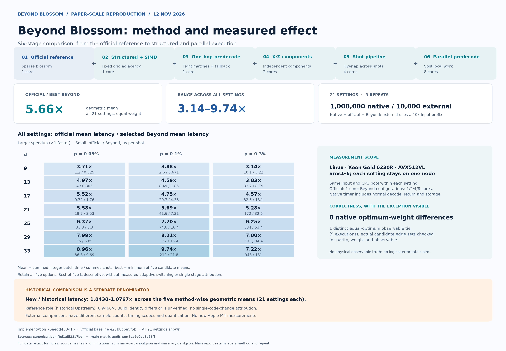
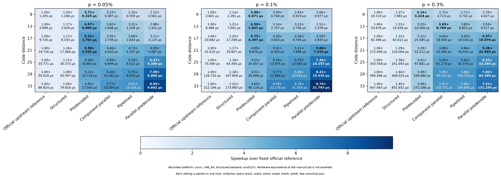
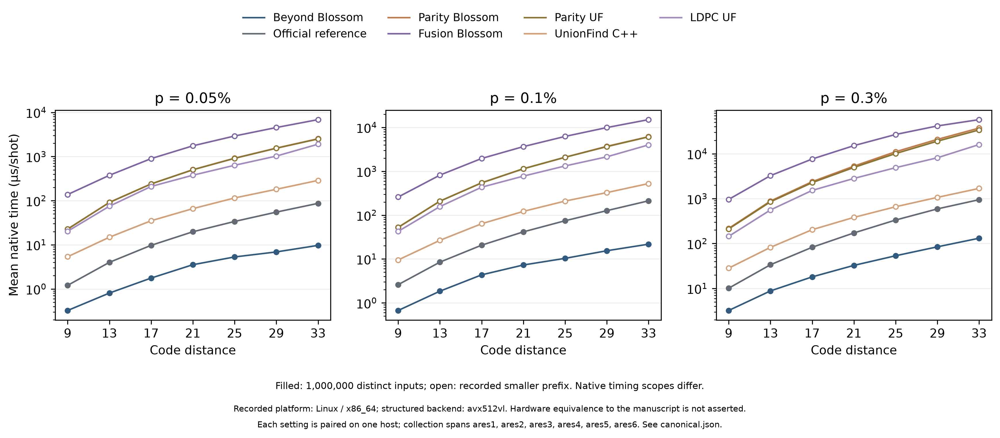
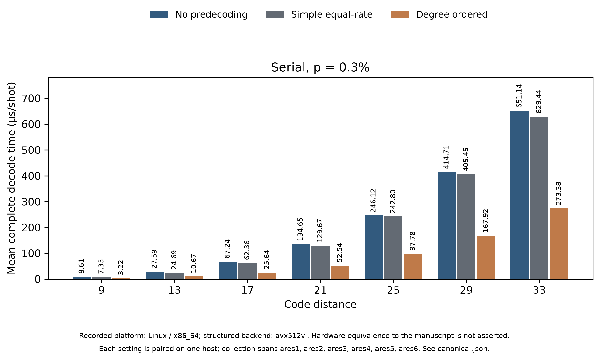
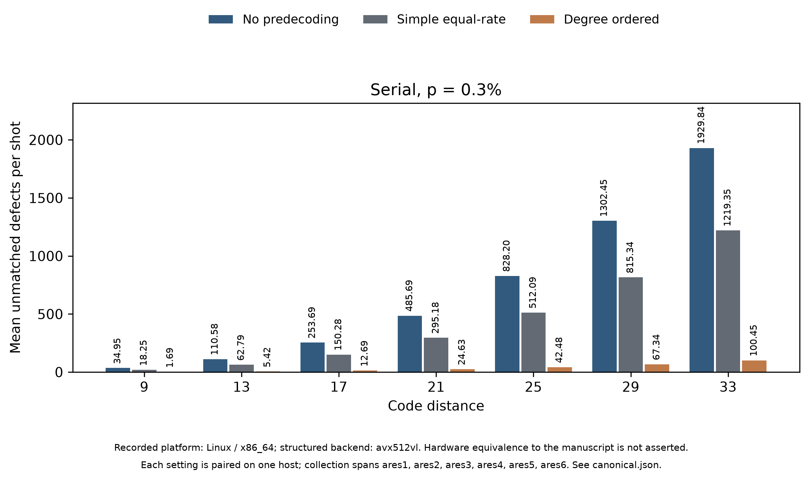

# Beyond Blossom：本地论文规模复现

21 组设置在 ares1, ares2, ares3, ares4, ares5, ares6 完成。每组原生方法使用 1,000,000 条保存输入，外部方法使用相同输入的 10,000 条前缀，均重复计时三次。逐设置选择最快 Beyond 配置后，相对固定官方参考的加速比为 3.14–9.74×，几何平均为 5.66×。

| 码距 | p = 0.05% | p = 0.1% | p = 0.3% |
| --- | --- | --- | --- |
| 9 | 0.325 / 1.205 (3.71×) | 0.671 / 2.601 (3.88×) | 3.224 / 10.110 (3.14×) |
| 13 | 0.805 / 3.999 (4.97×) | 1.847 / 8.489 (4.59×) | 8.789 / 33.676 (3.83×) |
| 17 | 1.761 / 9.720 (5.52×) | 4.357 / 20.682 (4.75×) | 18.070 / 82.496 (4.57×) |
| 21 | 3.535 / 19.726 (5.58×) | 7.310 / 41.610 (5.69×) | 32.593 / 172.066 (5.28×) |
| 25 | 5.300 / 33.771 (6.37×) | 10.357 / 74.590 (7.20×) | 53.395 / 333.558 (6.25×) |
| 29 | 6.886 / 55.010 (7.99×) | 15.435 / 126.720 (8.21×) | 84.380 / 590.566 (7.00×) |
| 33 | 9.692 / 86.824 (8.96×) | 21.793 / 212.194 (9.74×) | 131.254 / 947.665 (7.22×) |

表内为 Beyond / 官方参考的平均 μs/shot，括号内为参考耗时除以 Beyond 耗时。各设置在同节点、同一预定 CPU 池中依次运行，各方法按配置使用 1/2/4/8 核。

最快配置取自五种已测实现；它是逐设置的描述性选择，未测量运行时自适应切换。完整六阶段结果、每轮时间和实际配置见 CSV 与 canonical.json。

原生方法三轮批均值的最大相对跨度为 7.02%（最大值/最小值−1）。三轮用于展示重复波动，未据此给出统计显著性结论。

主矩阵的原生最优权重差为零。1 条独立输入出现等最优权重下的 observable 差异，涉及 9 次重复执行；这些差异均通过实际候选边集的奇偶、权重和 observable 验证。外部精确方法的最优权重差为零，UF 近似方法的差额保留在独立审计中。未保存物理 observable 真值，因此不据此比较逻辑错误率。

在 p = 0.3% 的串行对照中，度数顺序预解码相对关闭预解码的加速比为 2.38–2.67×。简单策略采用明确的半边等分模式 3；历史 coordinate/full-cap 模式 2 保留为独立实现。

原生计时覆盖正常解码调用、返回和结果存储；外部方法按各自原生接口计时，清理等边界存在差异。完整范围记录在每行 timing_scope，跨库曲线保留这些差异。

构建和输入生成在计时前完成。策略计数单独采集，排除统计开销；所有正式作业通过 Slurm 在 ares1–6 运行。d = 33、p = 0.3% 的独立 PMU 采集覆盖官方参考与结构化方法的 L2/L3，共四组独立计数，每组百万输入采集一遍。L2 分母为需求数据读请求，L3 分母为 LLC 读请求。

本次采集来自 Linux x86-64 / Intel Xeon Gold 6230R，结构化后端为 AVX512VL。Apple M4 仅完成已有数据重画；此归档不含新的 M4 测量。

新数据与论文历史归档分别保存。历史预解码表使用四线程 pipeline 和旧坐标顺序基线，本次采用串行模式，不能把两种口径的数值直接替换。

与历史主矩阵按设置对应后，五种 Beyond 配置的新/旧耗时比的几何平均为 1.0438–1.0767，参考角色为 0.9468。历史 CSV 的 Upstream 仅作角色对应，其构建身份未确认为本次独立官方参考。输入、构建和测量窗口不同，这些差异不能归因于单一代码改动。

独立 PMU 未命中率：misses / requests（%），d = 33、p = 0.3%。

| 缓存层级 | 官方参考 | 结构化方法 |
| --- | --- | --- |
| L2 | 60.1571 | 27.7622 |
| L3 | 0.1158 | 0.0192 |

原生六阶段：绝对耗时与相对官方参考加速比

外部对照：实心点为百万输入，空心点为一万条前缀

三种串行预解码策略的完整解码耗时

预解码后平均剩余事件数，单独统计

## 复现与证据

- [规范化测量数据](canonical.json)
- [原生方法](native.csv)
- [外部方法](external.csv)
- [串行策略](predecoder.csv)
- [逐设置配置选择](selected-configurations.csv)
- [论文宏与缺失项审计](macro-audit.json)
- [归档哈希](manifest.json)
- [小型证据与持久原始数据位置](archive-provenance.json)
- [独立重算、正确性与历史角色对照](evidence/validation/main-matrix-audit.json)
- [串行策略独立审计](evidence/validation/policy-matrix-audit.json)
- [PMU 独立审计](evidence/validation/pmu-audit.json)
- [仅从仓库重画图表](REPRODUCE.md)
- [重新采集](../../README.md)
- [简单等分策略完整交互](method/index.html)
- [固定版本代码对照](method/code-diff/index.html)

实现与采集源码：`75aedd433d1b129e5a973635320f199b5f26cbae`；官方参考：`e27b8c6a5f5ba10fb74d4ebb29822f2df5e12bcd`。

原始收据按字节归档，保留当时的路径。重画只读取仓库内的 canonical.json；新采集使用随库提供的依赖源码和配置。
