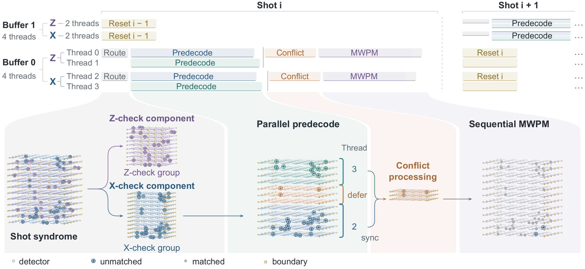
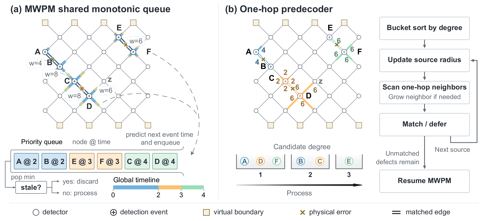
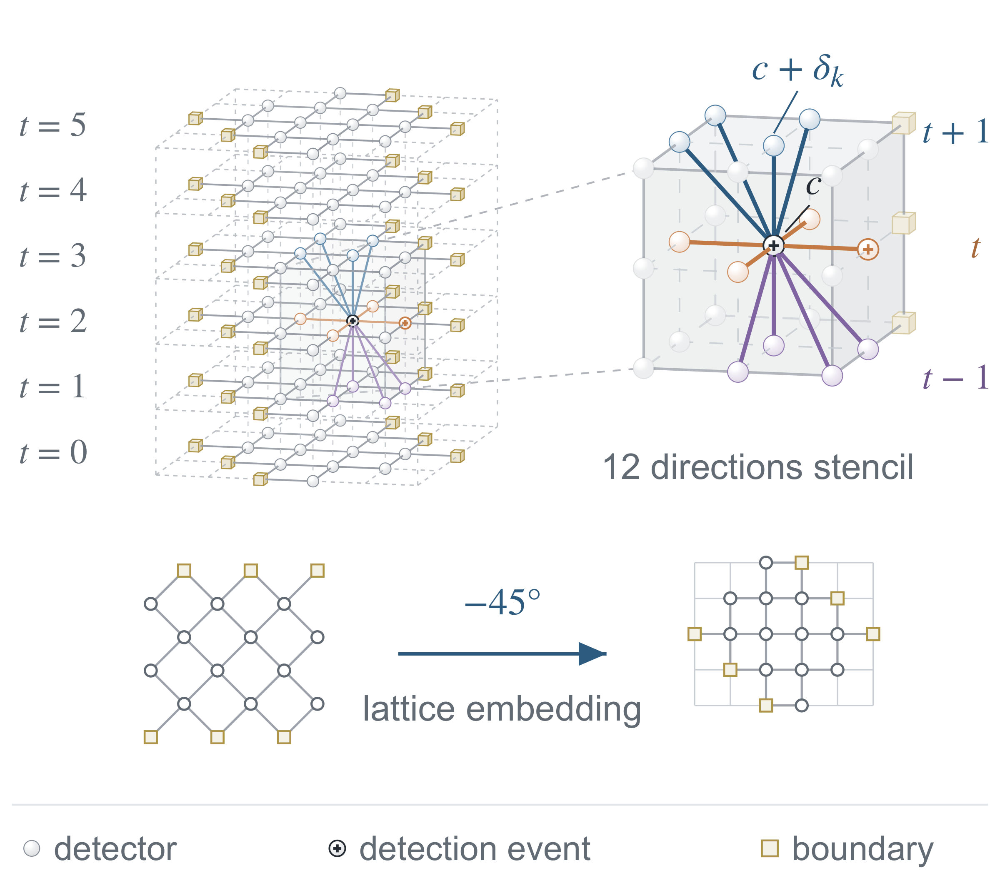

# Beyond Blossom

**Exact minimum-weight perfect matching for quantum error correction, accelerated through local predecoding, SIMD, and CPU parallelism.**

Beyond Blossom reduces the work needed to decode surface-code detection events while preserving the minimum-weight matching objective. It combines degree-ordered one-hop predecoding, a structured graph representation, and parallel execution across the decoding pipeline. It builds on PyMatching and provides Python APIs for arbitrary graphs (`Matching`) and structured surface-code graphs (`StructuredDecoder`), alongside a native C++ library.

[](assets/paper/parallel-architecture.png)

*Pipeline-wide parallelism from the paper. Independent components run concurrently; local predecoding is split across threads; alternating workspaces overlap reset with decoding the next shot. The remaining MWPM search runs sequentially within each component.*

[Installation](#installation) · [Structured decoding](#structured-decoding) · [Native build](#native-build) · [Reproduction](#reproduction-and-contributions)

## Core ideas

**Degree-ordered one-hop predecoding.** Common local patterns can be resolved directly through adjacent edges. The predecoder processes detection events in candidate-degree order, maintains a feasible dual state, and accepts tight-edge matches. Fully matched inputs have an optimal solution immediately. Otherwise, the partial matching and dual state initialize the full solver, which can revise those matches as needed.

[](assets/paper/one-hop-predecoding.png)

**Structured storage and SIMD.** Surface-code graphs are embedded in a three-dimensional lattice with a twelve-direction stencil. Fixed neighbor offsets and separate storage for frequently accessed state improve locality and allow several neighbor candidates to be evaluated together with SIMD.

<p align="center">
  <a href="assets/paper/structured-grid.png"></a>
</p>

**Parallelism around the remaining search.** Persistent worker teams combine independent-component decoding, parallel predecoding with a deferred conflict band, and overlapped reset. Single-core and multi-core strategies share the same exact matching objective; their usefulness depends on the workload and available cores.

These are the original method illustrations from the Beyond Blossom manuscript, exported for this README. [Figure sources and attribution](assets/paper/README.md) record their provenance. Measured results and their scope are linked under [Reproduction](#reproduction-and-contributions).

## Installation

A C++20 compiler, CMake 3.18+, Python 3.10+, and OpenMP are required. On Debian/Ubuntu, install `g++`, `cmake`, `python3-dev`, `python3-venv`, and `libgomp1`. On macOS, install CMake and LLVM OpenMP and pass the OpenMP prefix to CMake as needed.

```sh
python3 -m venv .venv
. .venv/bin/activate
python -m pip install .
```

Pinned Stim and GoogleTest source archives are bundled and verified locally; the default CMake build requires no dependency download. `CMAKE_ARGS` accepts ordinary CMake arguments, including `-DFETCHCONTENT_SOURCE_DIR_STIM=/path/to/stim` to use an explicit local source. Wheels build the native extension without requiring LTO. [Vendored dependencies](vendor/README.md) also cover the fixed reference and external AE decoders.

```python
import beyond_blossom as bb

matching = bb.Matching()
matching.add_edge(0, 1, fault_ids=0, weight=1.0)
matching.add_boundary_edge(0, fault_ids=1, weight=2.0)
print(matching.decode([1, 1]))
```

`Matching` accepts check matrices, NetworkX graphs, and Stim detector error models. A decoder instance owns mutable state; use a separate instance for each concurrent caller.

The installed Python console command is `beyond-blossom`; run `beyond-blossom --help`
for decoding options. The native CMake build provides `beyond_blossom` with the
same command interface.

## Structured decoding

Install the optional Stim dependency for this example with `python -m pip install '.[stim]'`.

```python
import stim
from beyond_blossom import StructuredDecoder

circuit = stim.Circuit.generated(
    "surface_code:rotated_memory_x", distance=5, rounds=5,
    after_clifford_depolarization=0.001,
)
model = circuit.detector_error_model(decompose_errors=True)
decoder = StructuredDecoder.from_detector_error_model(model, distance=5, rounds=5)
shots = circuit.compile_detector_sampler(seed=17).sample(shots=100)
predictions, weights = decoder.decode_batch(shots, return_weights=True)
print(decoder.metadata)
```

Geometry is explicit and validated against the detector coordinates. Strategies
are `structured`, `predecoded`, `component-parallel`, `pipelined`, and
`parallel-predecode`. Parallel strategies require an explicit `cpus` list of
2, 4, or 8 available CPU IDs respectively. On macOS these identify logical
slots; the runtime requests QoS rather than physical core affinity.
`decode_batch` reuses one worker team across the complete batch.

The C++ entry point is `beyond_blossom::structured::Decoder` in
`beyond_blossom/structured/decoder.h`. `Matching` and the unstructured native
driver support arbitrary graphs and correlated decoding.

## Native build

```sh
cmake -S . -B build -DCMAKE_BUILD_TYPE=Release -DBB_BUILD_PYTHON=OFF
cmake --build build --parallel 4
ctest --test-dir build --output-on-failure
```

Native consumers can link `BeyondBlossom::decoder` after `add_subdirectory`,
or install the library and use its CMake package:

```sh
cmake --install build --prefix /path/to/install
```

```cmake
find_package(BeyondBlossom CONFIG REQUIRED)
target_link_libraries(my_decoder PRIVATE BeyondBlossom::decoder)
```

`BB_PREDECODE_SIMD=ON` enables construction-time selection of the supported SIMD kernels. GNU and Clang x86-64 builds explicitly use the baseline x86-64 target; specialized functions enable their own SIMD features. The portable executable does not require AVX2 for every function. `BB_SANITIZERS=ON` enables ASan and UBSan. `BB_BUILD_PROFILE_TOOLS=ON` builds separate diagnostic tools; their instrumentation is excluded from the normal decoder.

The [unstructured](src/beyond_blossom/unstructured) and [structured](src/beyond_blossom/structured) backends are separate implementations with shared [core types and utilities](src/beyond_blossom/core). Backend selection occurs during decoder construction, and structured primal hot paths are inline definitions shared by callers.

## Reproduction and contributions

[AE/README.md](AE/README.md) describes smoke runs, full collection, and replay of archived paper data. Archived measurements describe their original binaries; a new build requires new measurements before a performance claim is made.

The [fresh paper-scale reproduction](AE/results/20261112/README.md) includes all 21 settings, million-shot native measurements, 10,000-shot external comparisons, serial predecoder statistics, and L2/L3 counters. Its figures, tables, source identities, and offline redraw entry are included in the repository.

[Migration validation, 2026-11-12](benchmarks/regression/results/20261112/README.md)
records this migration's correctness checks, paired measurements, and artifacts.

See [CONTRIBUTING.md](CONTRIBUTING.md) for development and [SECURITY.md](SECURITY.md) for reporting vulnerabilities. The software uses the [Apache License 2.0](LICENSE); original copyright notices are retained and attribution is recorded in [NOTICE](NOTICE). Paper artwork is documented separately in [assets/paper](assets/paper/README.md).
